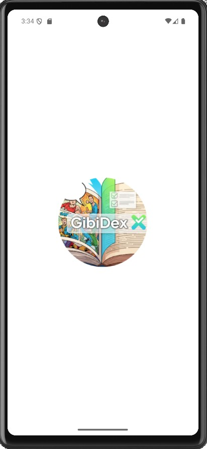
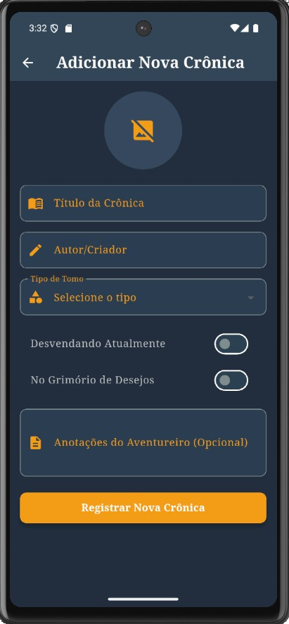
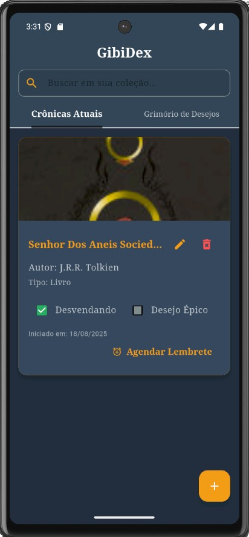
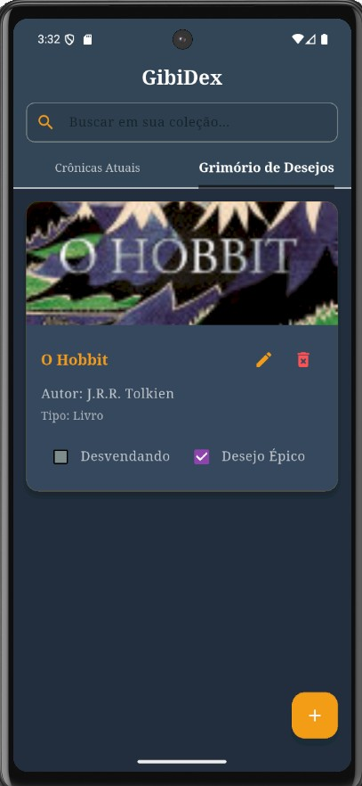

# 📚 GibiDex - Seu Organizador Pessoal de Livros e HQs

**GibiDex** é um aplicativo Flutter para organizar sua coleção de livros e histórias em quadrinhos, ajudando você a gerenciar o que já leu e o que deseja ler no futuro.

## ✨ Funcionalidades

✔ **Catálogo completo** de livros e HQs  
✔ **Filtros inteligentes**: Lendo, Desejados, Concluídos  
✔ **Busca automática** de capas via Google Books API  
✔ **Notificações** para lembrar de continuar leituras  

## 🛠 Stack Tecnológica

- **Hive** - Banco de dados NoSQL local
- **Provider** - Gerenciamento de estado
- **Google Books API** - Integração com dados de livros
- **flutter_local_notifications** - Sistema de lembretes

## 📱 Screenshots

📸 *Telas reais do app em funcionamento*

  
  
   
  
  

